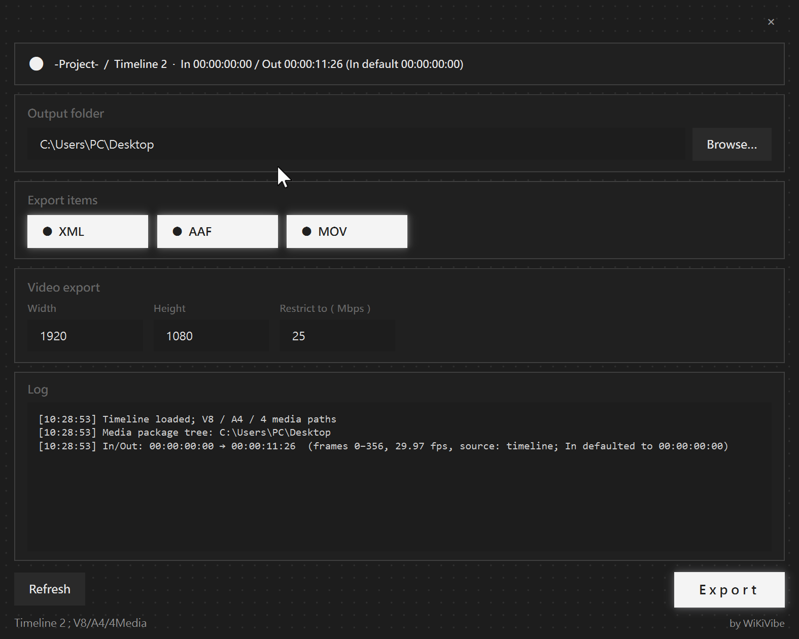

# WiKiVibe ExportHelper

English | [繁體中文](#繁體中文)

**Brand:** WiKiVibe · **Product:** ExportHelper  
Export **video XML**, **audio AAF**, and **MOV** (H.264, MP4 fallback) from DaVinci Resolve (DRT / Media Management workflows).

<p align="center">
  
</p>

---

## English

### New user — install & use (lazy path)

1. Download ZIP from GitHub → **Code → Download ZIP**
2. Unzip the folder
3. Double-click **`START_HERE.bat`** (first-time setup)
4. When the success dialog appears, open the app via:

| Open from | What you click |
|-----------|----------------|
| Desktop | **WiKiVibe ExportHelper** |
| Start Menu | **WiKiVibe → WiKiVibe ExportHelper** |
| Resolve | Restart Resolve → **Workspace → Scripts → WiKiVibe_ExportHelper** |
| Folder | **`Launch.bat`** (works portable or after install) |

**Before export:** DaVinci Resolve Studio must be running, with your DRT timeline open.

### Typical workflow

1. Finish Media Management in Resolve (transcode / DRT)
2. Import DRT → open the timeline
3. Set **In / Out** if you need MP4
4. Open ExportHelper → choose media root → toggle XML / AAF / MP4 → **Export**

### Output folder vs media package tree

These are **two different things**:

| | Meaning | Rule |
|--|---------|------|
| **Output folder** | Where XML / AAF / MP4 are written (no subfolder) | **Any folder you like** |
| **Media package tree** | Where timeline clips live on disk | Must share **one job parent folder** (default check **on**) |

#### Media package tree (default ON)

| Example | Result |
|---------|--------|
| `D:/test/Video/...` + `D:/test/Audio/...` | **OK** — common parent `D:/test` |
| `D:/test/Video/...` + `D:/test222/Audio/...` | **Blocked** — only share the drive `D:/` |
| Different drives (C: + D:) | **Blocked** |

```json
"require_media_same_package_tree": true
```

#### Output folder (always free)

You may write deliverables to `D:/test/Output` or `Desktop\ClientDrop` even when media lives under `D:/test/Video` and `D:/test/Audio`.

Optional extra rule (default **off**): also force media under the Output folder itself:

```json
"validate_media_under_selected_root": false
```

### Naming (how to recognize us)

| Layer | Name | Where you see it |
|-------|------|------------------|
| Brand | **WiKiVibe** | Start Menu folder, GitHub org |
| Product | **ExportHelper** | Display / product short name |
| Display | **WiKiVibe ExportHelper** | Desktop shortcut, window title |
| Resolve menu | **WiKiVibe_ExportHelper** | Workspace → Scripts |
| Install path | `%LOCALAPPDATA%\WiKiVibe\WiKiVibe_ExportHelper` | On disk after setup |

### Folder layout (source ZIP)

```text
WiKiVibe_ExportHelper/
  START_HERE.bat          ← double-click first (install)
  Launch.bat              ← run the app
  Install.bat             ← same as START_HERE (alias)
  InstallResolveScript.bat← optional: Resolve menu only
  README.md
  LICENSE
  requirements.txt
  app/                    ← application files
    export_helper.py
    config.json
    assets/
      app.ico
  setup/                  ← installer / launcher scripts
    Install.ps1
    Launch.ps1
    InstallResolveScript.ps1
  tools/                  ← maintainer helpers (optional)
```

Exports write **directly** into the chosen Output folder (no `DELIVERABLES` subfolder, no `package_report` files).  
**MOV** video prefers **QuickTime `.mov`** (H.264), falls back to **MP4**. Quality uses UI **Restrict to (Mbps)** first, then auto.  
NetworkOptimization / MultiPass / ExportSubtitle are soft-applied when the API accepts them.  
If In is not set, it defaults to **00:00:00:00**; missing Out shows **(incomplete)** in orange-red.

After install, a clean copy lives at:

```text
%LOCALAPPDATA%\WiKiVibe\WiKiVibe_ExportHelper\
```

### Requirements

- Windows 10/11
- DaVinci Resolve **Studio**
- Python 3.10+ ([python.org](https://www.python.org/downloads/) — enable *Add python.exe to PATH*)

### CLI (optional)

```bat
python app\export_helper.py --preflight
python app\export_helper.py --export "D:\Projects\Show_Episode01" --skip-mp4
python app\export_helper.py --self-test
```

### Uninstall (manual)

1. Delete `%LOCALAPPDATA%\WiKiVibe\WiKiVibe_ExportHelper`
2. Delete Desktop / Start Menu shortcuts under **WiKiVibe**
3. Delete `%APPDATA%\Blackmagic Design\DaVinci Resolve\Support\Fusion\Scripts\Utility\WiKiVibe_ExportHelper.py`

### License

MIT — see [LICENSE](LICENSE). by [WiKiVibe](https://github.com/WiKiVibe)

---

## 繁體中文

### 新使用者 — 怎麼裝、怎麼用（懶人版）

1. 從 GitHub 下載 ZIP（**Code → Download ZIP**）
2. 解壓縮
3. **雙擊 `START_HERE.bat`**（第一次安裝）
4. 看到成功視窗後，用下面任一方式開啟：

| 從哪開 | 點什麼 |
|--------|--------|
| 桌面 | **WiKiVibe ExportHelper** |
| 開始功能表 | **WiKiVibe → WiKiVibe ExportHelper** |
| Resolve | 重開 Resolve → **Workspace → Scripts → WiKiVibe_ExportHelper** |
| 資料夾 | **`Launch.bat`** |

**輸出前：** 請先開啟 Resolve Studio，並打開你的 DRT timeline。

### 常見流程

1. 在 Resolve 做完 Media Management（轉碼／DRT）
2. 匯入 DRT、打開 timeline
3. 若要 MP4，先設 **In／Out**
4. 開 ExportHelper → 選媒體根目錄 → 勾選 XML／AAF／MP4 → **Export**

### 輸出資料夾 vs 媒體專案樹

這是**兩件事**：

| | 意思 | 規則 |
|--|------|------|
| **Output folder** | 成品 XML／AAF／MP4 寫去哪（不再建子資料夾） | **任意資料夾都可以** |
| **媒體專案樹** | timeline 素材在硬碟哪裡 | 必須在**同一個專案父資料夾**下（預設檢查 **開**） |

#### 媒體專案樹（預設會擋不合理的）

| 例子 | 結果 |
|------|------|
| `D:/test/Video/...` + `D:/test/Audio/...` | **可以** — 共同父層 `D:/test` |
| `D:/test/Video/...` + `D:/test222/Audio/...` | **會擋** — 只共用碟符 `D:/` |
| 不同磁碟（C: 與 D:） | **會擋** |

```json
"require_media_same_package_tree": true
```

#### 輸出資料夾（永遠自由）

媒體在 `D:/test/Video` 與 `D:/test/Audio`，輸出仍可選 `D:/test/Output` 或別的交付資料夾。

可選：連「媒體也要在 Output 底下」都檢查（預設關）：

```json
"validate_media_under_selected_root": false
```

### 命名怎麼記

| 層級 | 名稱 | 你會在哪看到 |
|------|------|----------------|
| 品牌 | **WiKiVibe** | 開始功能表資料夾、GitHub |
| 產品 | **ExportHelper** | 產品簡稱 |
| 安裝資料夾 | **WiKiVibe_ExportHelper** | 硬碟／ZIP 資料夾名 |
| 顯示名稱 | **WiKiVibe ExportHelper** | 桌面捷徑、視窗標題 |
| Resolve 選單 | **WiKiVibe_ExportHelper** | Workspace → Scripts |
| 安裝位置 | `%LOCALAPPDATA%\WiKiVibe\WiKiVibe_ExportHelper` | 硬碟路徑 |

成品會**直接**寫進你選的 Output 資料夾（不再建立 `DELIVERABLES`、也不再寫 `package_report`）。  
**MOV** 優先 **QuickTime `.mov`**（H.264），失敗才退 **MP4**。品質用 UI **Restrict to（Mbps）**，再 fallback auto。  
字幕／NetworkOptimization 等為 **best-effort**。  
沒打 In 點時預設 **00:00:00:00**；抓不到 Out 時，狀態列會以**橘紅色**顯示 `(incomplete)`。

### 資料夾分層（下載的 ZIP）

- 根目錄：`START_HERE.bat`（先裝）、`Launch.bat`（之後開）
- `app\`：主程式
- `setup\`：安裝／啟動腳本（一般不用手動開）

### 授權

MIT（見 [LICENSE](LICENSE)）· [WiKiVibe](https://github.com/WiKiVibe)
